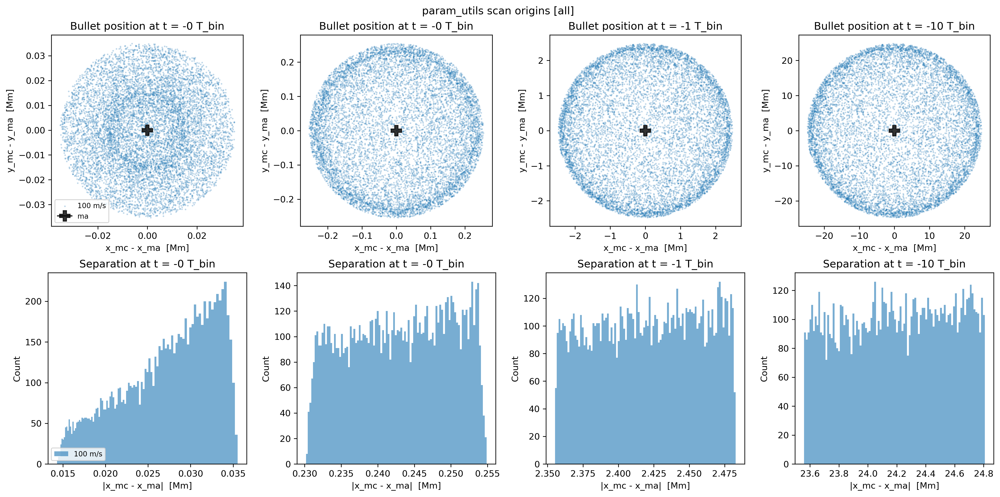
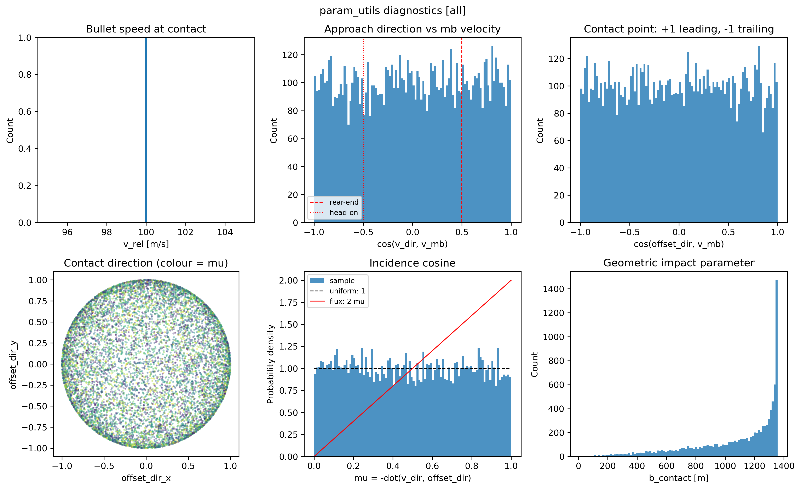
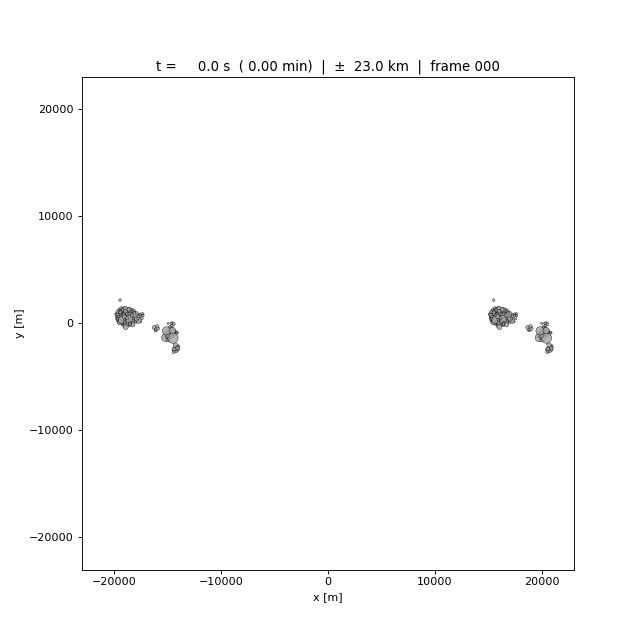
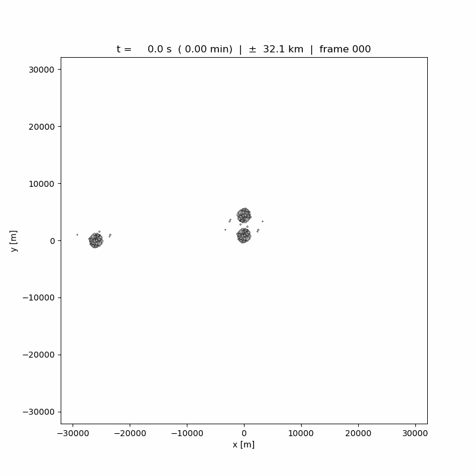
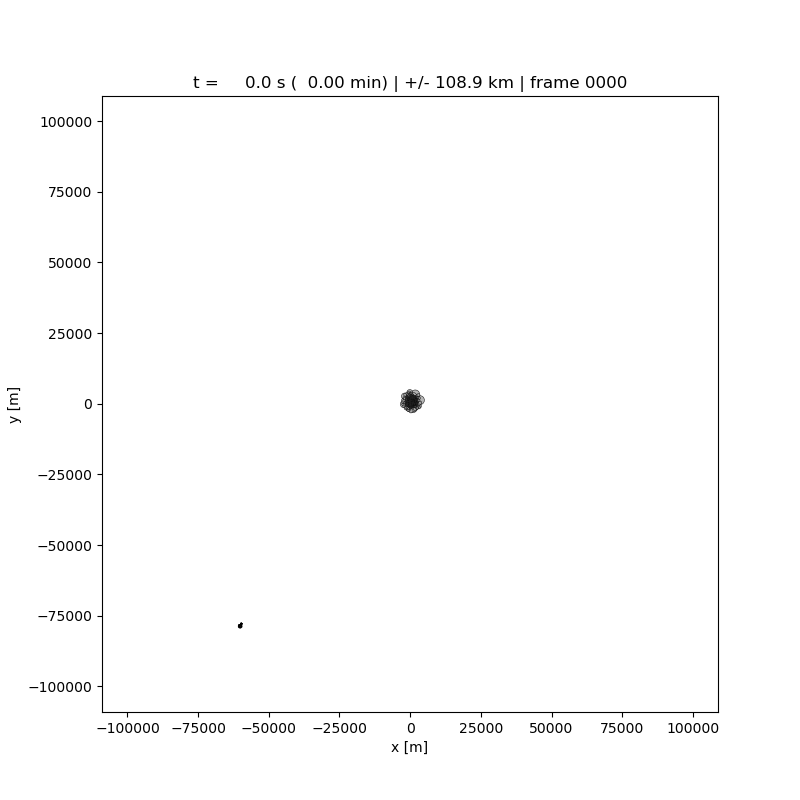

# strw-asteroid-ringforge

[](https://www.python.org/)
[](https://github.com/conda-forge/miniforge)
[](https://rebound.readthedocs.io/)
[](https://amusecode.github.io/)
[](https://shouldideploy.today/)

**Rubble-pile asteroid collisions, simulated with REBOUND and rendered to MP4 or GIF.**

*Settle, collide, and animate self-gravitating rubble piles to probe ring formation.*

---

## Table of contents

- [Overview](#overview)
- [Pipeline](#pipeline)
- [Quick start](#quick-start)
- [Configuration](#configuration)
- [Project layout](#project-layout)
- [Design notes](#design-notes)
- [Roadmap](#roadmap)
- [Housekeeping](#housekeeping)
- [Parameter space analysis](#parameter-space-analysis)
- [Example collisions](#example-collisions)

---

## Overview

> [!NOTE]
> The name is a placeholder, we are investigating if rings around asteroids can form.
>
> Current sim written with native [`REBOUND`](https://github.com/hannorein/rebound).
>
> We aim to use [`AMUSE`](https://github.com/amusecode/amuse)
> interface down the road for easy testing across multiple codes.

1. We build self-gravitating rubble-pile asteroids from a power-law size distribution.
2. We relax the rubble piles under their own gravity.
3. We smash them together and render the aftermath to an animated `MP4` or `gif`.

---

## Pipeline

```text
   ┌────────────────┐     ┌────────────────┐     ┌────────────────┐
   │  Build clump   │───▶│  Settle        │───▶│  Cache state   │
   │  power-law r   │     │  REBOUND       │     │  hashed .npz   │
   └────────────────┘     └────────────────┘     └────────────────┘
                                                          │
                                                          ▼
   ┌────────────────┐     ┌────────────────┐     ┌────────────────┐
   │  MP4 / GIF     │◀───│  Render frames │◀───│  Collision     │
   │  ffmpeg + PIL  │     │  matplotlib    │     │  scene builder │
   └────────────────┘     └────────────────┘     └────────────────┘
```

> [!NOTE]
> Settled asteroids are cached.
> The collision, render, and encode stages reuse these items.

---

## Quick start

### 1. Clone and enter the repository

```sh
git clone https://github.com/Yang-Taotao/strw-asteroid-ringforge.git
cd strw-asteroid-ringforge
```

### 2. Create and activate the conda environment

```sh
# Typical env when amuse interface is needed
conda env create -f env.yml -n amuse-py313
conda activate amuse-py313
```

### 3. Run sim

```sh
# Default: stream a grayscale MP4
python main.py

# Use a realisation from a parameter scan
python main.py --param-path data/param_scan_test --param-index 42

# Force re-settlement of every asteroid
python main.py --overwrite-settled

# Keep the per-run frame chunks for post-mortem inspection
python main.py --keep-frames

# Control the chunk write size (frames per .npz)
python main.py --chunk-size 100

# List the settled-body cache library
python main.py --list-settled

# Re-encode an existing chunk directory without rerunning the sim
python main.py --rebuild-video data/collision_frames_<run_id>
python main.py --rebuild-gif data/collision_frames_<run_id>
```

> [!TIP]
> Only need to settle once for asteroid with the same mass and particle count.
>
> The asteroids are saved under unique path with a hash to ensure uniqueness.
>
> `--seed` only affects run-level selection, such as which scan realisation is used.
>
> `--placement-seed` controls asteroid construction and therefore the cache key.

### 4. Find results

| Artifact                        | Location                                          |
| ---                             | ---                                               |
| Settled asteroid states         | `./data/settled_M<mass>_N<N>_<hash>.npz`          |
| Parameter scan                  | `./data/param_scan_test/chunk_XXXX.npz`           |
| Per-run frame chunks (optional) | `./data/collision_frames_<run_id>/chunk_XXXX.npz` |
| Final video                     | `./media/vid/vid_<run_id>.mp4`                    |
| Final GIF                       | `./media/gif/gif_<run_id>.gif`                    |
| Run metadata                    | `./data/run_<run_id>.json`                        |
| Run log                         | `./logs/ringforge_main_<timestamp>_<pid>.log`     |

> [!TIP]
> An MP4-only run streams frames straight to `ffmpeg` and writes no frame chunks.
>
> Use `--keep-frames` or `--media-format both` when you want the chunks.

---

## Configuration

Defaults live in `config.toml`, loaded by `config.py`.
Command-line flags override them for one run.

| Section     | What it controls                                         | Defaults                                  |
|---          |---                                                       |---                                        |
| `[run]`     | `seed`, `placement_seed`, data/media/log directories     | `42`, `42`, `data`, `media`, `logs`       |
| `[bodies]`  | masses, density, size slope, radius range, counts        | `1e15`, `1e13`, `1e12` kg; `3000` kg/m3   |
| `[settle]`  | settle time, dt, softening, integrator, stability gate   | `108000` s, `10` s, `20` m, `leapfrog`    |
| `[impact]`  | bullet speed, post-impact tail, dt, steps per frame      | `100` m/s, `18000` s, `1` s, `5`          |
| `[render]`  | media format, colour mode, fps, CRF, DPI                 | `mp4`, `gray`, `20`, `20`, `100`          |
| `[scan]`    | geometry, realisations, workers, chunk size, lookbacks   | `uniform`, `10000`, `16`, `2000`          |

`n1`, `n2`, and `n3` set the target particle counts for host 1, host 2, and the
bullet. `--particles-per-body` overrides all three with the same count.

> [!IMPORTANT]
> Every parameter that influences the settled state is hashed into the
> cache filename. Change `size_slope` and you get a fresh file; change
> only the impact speed and the settlement is reused.

---

## Project layout

```sh
.
├── config.py                    # config loader
├── config.toml                  # global defaults
├── data                         # simulation data
│   ├── collision_frames_xxx     # optional frame chunks
│   ├── param_scan_test          # parameter scan results
│   ├── run_xxx.json             # per-run metadata
│   └── settled_xxx.npz          # settled asteroid states
├── env.yml                      # conda env
├── LICENSE
├── logs                         # run logs
├── lumberyard.py                # logger utils
├── main.py                      # simulation pipeline
├── media                        # rendered media
│   ├── gif                      # GIF output
│   ├── param_scan_test_diag.png # scan diagnostics
│   ├── param_scan_test.png      # scan summary
│   └── vid                      # MP4 output
├── param_utils.py               # scan, plot, and read utilities
├── pyproject.toml
├── README.md
├── run_cases.sh                 # batch case runner
└── src
    └── ringforge                # module placeholder
```

---

## Design notes

### Stage 1 — Settle a single asteroid

1. Sample radii from a power law `p(r) \sim r^slope` on `[R_MIN, R_MAX]`.
2. Rescale the radii to hit the target mass, then reject-sample positions inside
   a sphere of radius `ball_radius_for(N)` until no two particles overlap.
3. Integrate with **REBOUND** using `leapfrog` by default (`ias15` is available),
   tree gravity, and hardsphere collisions.
   - For `leapfrog`, the timestep is limited by `safety * r_min / v_max`.
4. Check that the settled body is bound, compact enough, and cold enough:
   - bound mass fraction, extent, and RMS speed must pass the configured gate.
5. Save the state as a `(N, 7)` array of `[x, y, z, vx, vy, vz, r]`.

### Stage 2 — Build the three-body scene

Given three settled asteroids `a`, `b`, `c` with `ma >> mb >> mc`:

- `a` and `b` form a pseudo-binary at the origin
- `c` is launched from the left as an impactor
  - With a rear-ending trajectory that injects energy into the system
- With `--param-path`, the scene instead uses one realisation from a scan
  - either the contact state or a selected lookback snapshot

> [!NOTE]
> Offsets are expressed as unit vectors scaled by `separation`
>
> With bulk velocities as unit vectors scaled by `BULLET_SPEED`.

### Stage 3 — Render

The renderer holds a single `matplotlib` figure and one `Circle` artist per particle.
We update the centres at each frame and rasterise through an explicit `FigureCanvasAgg`.
This is bound to a `numpy` buffer.
This keeps the per-frame cost dominated by the integration, not by artist construction.

An MP4 run streams frames straight to `ffmpeg`.
For GIF runs, `both`, and `--keep-frames` instead flush numbered chunk files
`chunk_XXXX.npz`, so memory stays bounded.

### Stage 4 — Encode

MP4 output goes through `ffmpeg` as H.264 / `yuv420p`.
The default grayscale frames reduce memory usage.

GIF output reads back one chunk at a time, converts each frame to paletted P-mode,
and appends it to the `PIL` frame list.
Peak memory during encoding is then bounded by the P-mode size, not by the raw RGB size.

---

## Roadmap

### Primary

- [ ] Translate to a `tidymess` backend with `AMUSE` interface
- [ ] Add dedicated parallelisation module for HPC deployments

### Intermediate

- [x] Backwards calculation from the moment of impact for init param sweep constraints.
- [x] Parameter sweep utility, driven by the hash-keyed cache.
- [ ] Collision-outcome and stopping criteria derived from bounding
      energy rather than fixed `POST_IMPACT_TAIL`.
- [ ] Add flag for single particle replacement for host `a`.
- [ ] Test mass regime on `a`, `b`, and `c` with other cases such as planet and moon.

---

## Housekeeping

### Environment

Requires env management via [**conda**](https://github.com/conda-forge/miniforge).

The `env.yml` file is generated with:

```sh
conda env export --no-builds | grep -v "^prefix:" > env.yml
```

To reproduce and activate this environment under a custom name such as `amuse-py313`:

```sh
conda env create -f env.yml -n amuse-py313
conda activate amuse-py313
```

### REBOUND

> [!WARNING]
> The current implementation relies on a **native** `REBOUND` build.
>
> This is different from the common `AMUSE` interface usage for `REBOUND`.

### Conventions

- Frame chunks store `(N, H, W)` grayscale or `(N, H, W, 3)` RGB `uint8` arrays.
- Every settled asteroid has a short `SHA1` fingerprint of the input params.
- Run metadata and logs are written per run.
- Settled asteroids of identical particle count and mass are reused across runs.

---

## Parameter space analysis

We integrate backwards from potential collision to find the initial conditions.

### 1. Example param space scan

We make 10000 realisations of potential impacts across 16 workers with seed 42:

```sh
python param_utils.py scan --n 10000 \
   --out data/param_scan_test \
   --workers 16 --chunk 2000 --seed 42
```

> [!TIP]
> Use `python param_utils.py scan --test` for quick test
>
> This runs the standard 10k scan and then the standard plots plus KS tests.

### 2. Example param space scan visualization and diagnostics

The associated visualization and diagnostics plots are rendered by:

```sh
python param_utils.py plot data/param_scan_test \
   --diagnostics media/param_scan_test_diag.png \
   --out media/param_scan_test.png
```

### 3. Parameter scan initial bullet locations



### 4. Parameter scan results diagnostics



### 5. Inspect one realisation

```sh
python param_utils.py read data/param_scan_test --index 42
```

The scan supports two direction samplings:

- `uniform`: flat in `mu = -dot(v_dir, offset_dir)`
- `flux` isotropic, `p(mu) = 2 mu`

The default lookbacks are `[0.01, 0.1, 1, 10]` in units of `T_bin`.

---

## Example collisions

We have created some preliminary collision results to showcase here.

### 1. Head-on collision



### 2. Pseudo binary with incoming bullet - identical asteroids



### 3. Close and far binary separations




### 4. Param index 42 collision case
<!-- markdownlint-disable MD033 -->
<video src="./media/vid/vid_20261029_153925_775643_p042_43293.mp4" width="800" height="800" controls></video>
<!-- markdownlint-enable MD033 -->
---

**Built with coffee and tea at [STRW](https://www.strw.leidenuniv.nl/)**
